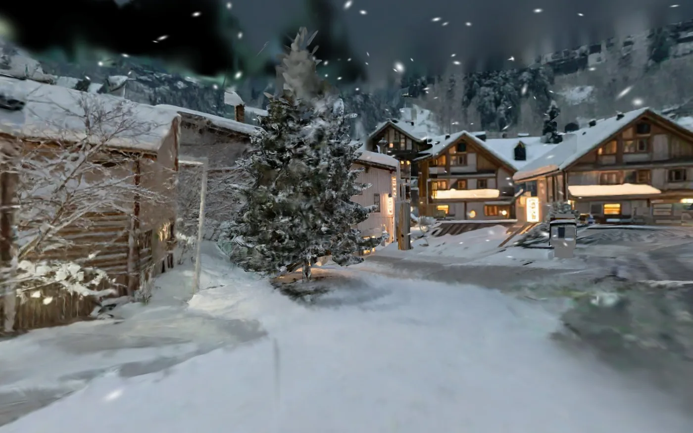
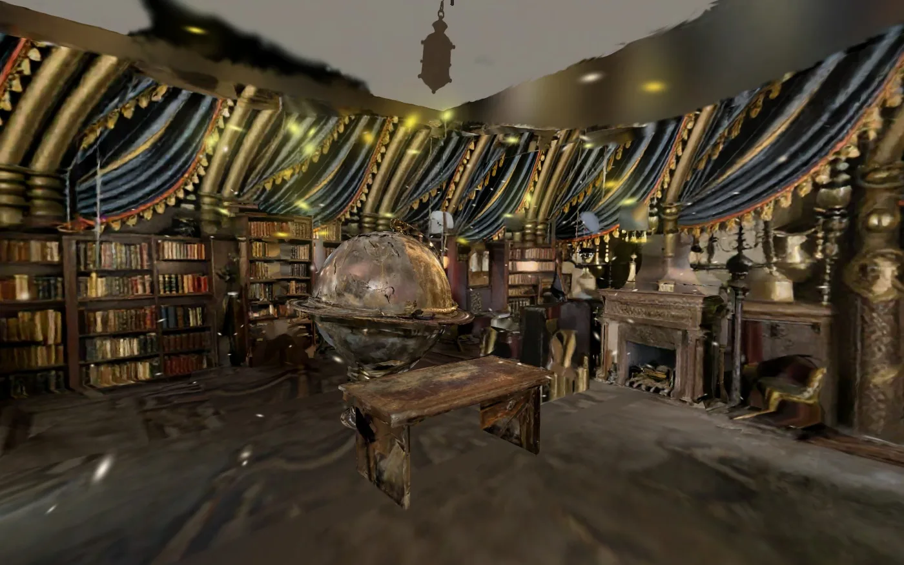
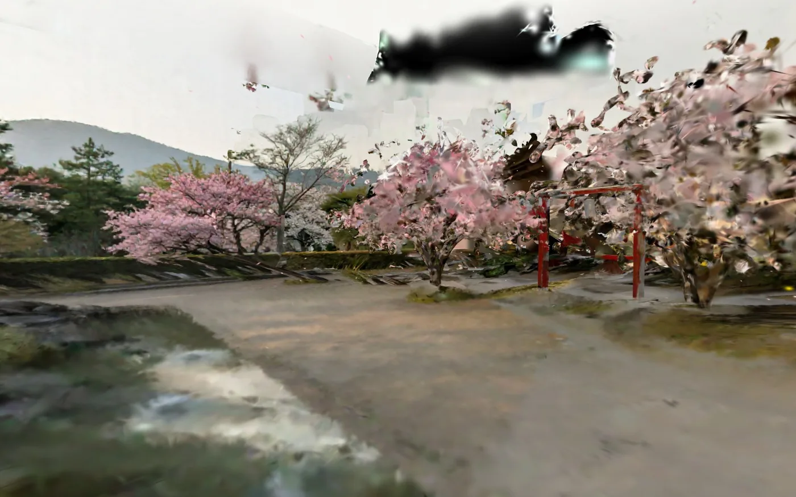
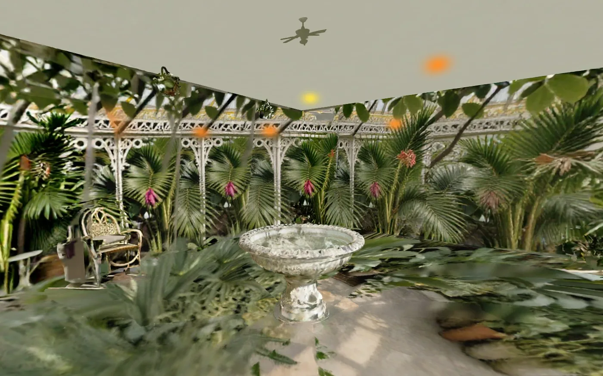
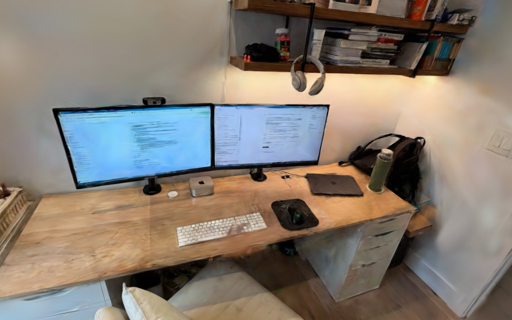

# Prometheus Worlds

**The frontier of locally generated worlds.**

How good a world can you generate on a 64 GB Mac? This project wants to find out. It is open source, and contributions are welcome.

**[Join the Discord](https://discord.gg/MgucVj7sJ)** · [Website](https://prometheus-worlds.vercel.app)



| | |
|---|---|
|  |  |
| Alchemist's Tower Study | Cherry Blossom Garden |
|  |  |
| Palm Conservatory | The office, rebuilt from 20 phone photos |

Every world above came from a sentence or a handful of photos, built on one Mac with no cloud service.

## What it is

Prometheus Worlds is an open source world builder. It does four things:

- **Sentence to world.** Generate a world from a description.
- **Photos to world.** Rebuild a real room from photos.
- **Stitching.** Put worlds side by side and walk from one to the next.
- **Export.** Take a world into a game engine. Godot first.

A world is four things: **visuals** (what you see from anywhere you stand), **colliders** (what you can't walk through), **sound** (what you hear, and where from) and **motion** (what moves without you).

## Status

| | Visuals | Colliders | Sound | Motion |
|---|---|---|---|---|
| Sentence to world | Rough up close | Works | Works | Works, rigid |
| Photos to world | Rough, needs 60+ photos | Works, some holes | Missing | Missing |
| Stitching | Works | Works | Untested | Untested |
| Export | Missing | Missing | Missing | Missing |

Every "rough" and "missing" is a place to help. See [CONTRIBUTING.md](CONTRIBUTING.md).

## The rules

- One machine, 64 GB of memory max.
- Open models only.
- No accounts, no cloud, no analytics, no external APIs.

These are what make it a challenge. A change that breaks one of them will not be merged.

## Requirements

- An Apple Silicon Mac with 64 GB of memory. Developed on an M4 Pro.
- macOS 14 or later.
- [Xcode](https://apps.apple.com/app/xcode/id497799835). Nothing else: the app brings its own Python and everything it needs.
- About 40 GB of free disk for tools and model weights.

## Build it

1. Clone the repository.
2. Open `Prometheus Worlds.xcodeproj` in Xcode.
3. Press **Run**.

On first launch the app sets itself up and shows its progress: a self-contained Python, its packages (including COLMAP, as pycolmap), the layout model and the optional 3D shape model. It all goes inside the project folder; nothing is installed on the system, and every download is pinned and checked. That takes a while and needs the internet once. The image models (about 20 GB) download the first time you build a world. After that, everything runs offline.

If a step fails, the window shows why. Fix it, quit, and open the app again: setup carries on from where it stopped.

The app runs from your checkout, so keep the folder where it is. Your worlds are saved in `thread/worlds/`.

**From the command line instead:**

```bash
./setup.sh
```

```bash
app/build.sh
```

`setup.sh` needs only Xcode and is safe to run again; `./setup.sh --no-shapes` skips the 3D shape model. `app/build.sh` builds `app/Prometheus Worlds.app` with Xcode's tools. To run without the app at all:

```bash
thread/.venv/bin/python thread/server.py 8765
```

Then open `http://127.0.0.1:8765/viewer/index.html`.

## Using it

In the app, choose **New world…**, then **From your photos** or **From a prompt**. One world is built at a time, and a panel in the corner shows progress. A prompt world takes about 30 minutes at Standard detail.

In the viewer: **W A S D** to move, drag to look, **Q** and **E** for down and up, Shift to go faster. Tick **Tour** for a hands-free glide, **Sound** for music and scene sounds, and **Drop balls** to test the colliders. **Stitch worlds…** puts worlds side by side.

## Models

| Model | Job | Runs through |
|---|---|---|
| Qwen3.5 9B (MLX 4-bit) | Layout sentence to a blockout | mlx-lm (MLX) |
| Z-Image Turbo + Z-Image-Turbo-Fun-Controlnet-Union 2.1 (`2601-8steps`) | Painting views that follow the blockout | mflux (MLX) |
| Depth Pro | Depth for each photo | mflux (MLX) |
| Hunyuan3D 2.0 shape (mini), optional | One picture of an object to a 3D mesh | [Hunyuan3D-Swift](https://github.com/ZimengXiong/Hunyuan3D-Swift) (MLX) |

COLMAP (through pycolmap), msplat, Open3D, three.js, Spark and Rapier do the rest. Exact versions are pinned in `runtime/*.lock` and `setup.sh`. Each model has its own licence; check them before using this for anything beyond personal use.

## How it works

[docs/how-it-works.md](docs/how-it-works.md) has the detail: both pipelines step by step, moving things and outdoor places, stitching, speed measurements, what was tried and dropped, and the known limits.

In short: a sentence becomes a blockout of boxes and generated shapes, an image model paints views that follow it, the views are made to agree and re-projected to about 115 training views, and a Gaussian splat is trained from them. Photos go through COLMAP, a splat trainer and Depth Pro for the mesh. The viewer is three.js with Spark for splats, Rapier for physics and Web Audio for sound; the three libraries are vendored in `thread/viewer/vendor/`, so there is no Node.js dependency.

## Repository layout

| Path | What |
|---|---|
| `Prometheus Worlds.xcodeproj` | Open this and press Run (generated from `project.yml` by XcodeGen) |
| `setup.sh` | First-run setup: Python, packages, models, all inside the folder |
| `runtime/` | Pinned package lists (with hashes) for the two Python environments |
| `app/` | The macOS app: `main.swift`, `Info.plist`, `build.sh`, `make_icon.py` |
| `thread/server.py` | Local server: static files plus the job API |
| `thread/pipeline.py` | The two pipelines |
| `thread/llm_boxes.py` | Layout sentence to blockout |
| `thread/shapes.py` | Real 3D shapes for objects |
| `thread/chisel_ring.py` | Painting views (runs in `spike/.venv`) |
| `thread/consistent.py` | Making the views agree, training views |
| `thread/movers.py` | Lifting moving things out as their own splats |
| `thread/viewer/` | The viewer page |
| `thread/tests/` | Unit tests |
| `spike/` | The image-model environment and `blockout.py`, the blockout renderer |
| `experiments/` | Tests and studies behind past decisions |
| `ext/` | Third-party code and weights fetched at build time (not in git) |
| `thread/worlds/`, `thread/scenes.json` | Your built worlds (not in git) |

## Contributing

See [CONTRIBUTING.md](CONTRIBUTING.md). In short: open an issue or a pull request, or fork it and send a link to your fork. Questions and show-and-tell go in the [Discord](https://discord.gg/MgucVj7sJ).

## License

[MIT](LICENSE).
